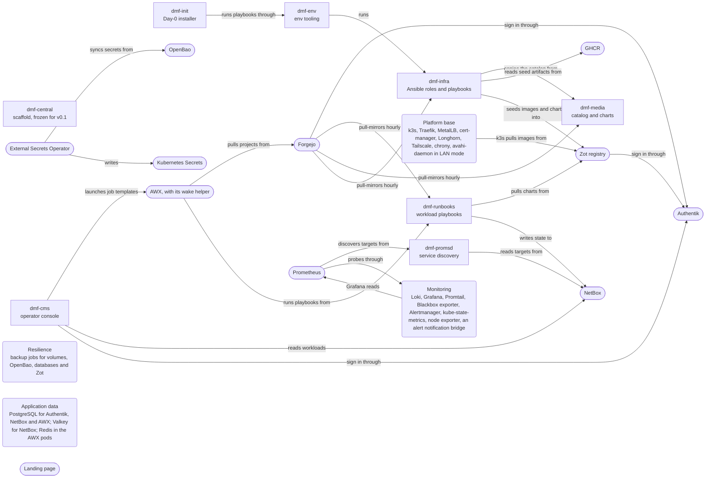

# The parts of the platform

This page shows the component repos, the services identified in the dmf-infra bootstrap roles, their explicitly configured bundled
data stores, and the host daemons they set up. The audit searched the values, templates and resources in those role directories for
databases, caches and brokers. It did not audit upstream chart defaults or the dmf-cms and dmf-promsd chart repositories.

Boxes are component repos. Stadium shapes are services or named external systems and resources; rounded boxes group services,
with their members listed. An arrow points from the part that acts to the part it reads or writes. `dmf-infra` deploys the platform
services; GHCR is external, and External Secrets Operator writes Kubernetes Secrets. `dmf-infra` also deploys `dmf-promsd` and
`dmf-cms`. The [Services](#services) table lists each service once, including the members of the groups.

AWX reads its projects, including `dmf-runbooks`, through the Forgejo mirror.

Not drawn: the host setup that has no daemon of its own (baseline packages, hardening, kernel mitigations and audit log archival,
see the Host setup row below) and the network policies for OpenBao. The repo `dmfdeploy` is the umbrella of these docs and makes no calls.

## What comes from GitHub

GitHub and GHCR are the public source. AWX projects use the Forgejo copies. Catalog launchers and the seeded platform images use Zot.
Other images may come from their configured registries. Forgejo pulls from GitHub every hour by default.

| What | From | Into | By |
|---|---|---|---|
| The `dmf-runbooks`, `dmf-media` and `dmf-infra` repos | GitHub | Forgejo | Pull-mirror, hourly by default |
| The images that playbook 630 selects, and the media-function charts (`nmos-cpp`, `nmos-crosspoint`, `mxl-fabrics-demo`) | GHCR (two images come from another public registry) | Zot | Playbook 630, at bootstrap and when you re-run it |

## Services

Paths are relative to `k3s-lab-bootstrap/` in the `dmf-infra` repo.

| Service | Layer | Installed by | What it is for |
|---|---|---|---|
| k3s | Platform base | `playbooks/300-k3s.yml` | Runs the containers |
| Traefik | Platform base | `playbooks/310-ingress-public.yml`, `playbooks/311-ingress-private.yml` | Routes web traffic into the cluster |
| MetalLB | Platform base | `roles/base/ingress`, called by `playbooks/310-ingress-public.yml` in the MetalLB ingress modes only | Gives services an address on the local network |
| cert-manager | Platform base | `playbooks/320-cert-manager.yml` | Issues TLS certificates |
| Longhorn | Platform base | `playbooks/330-longhorn.yml` (cloud provider profile only) | Stores volumes, replicated across nodes |
| Tailscale | Platform base | `playbooks/321-tailscale.yml` (cloud provider profile only) | Connects the nodes, and sets public DNS |
| Host setup | Platform base | `playbooks/200-baseline.yml`, `205-chrony.yml`, `210-harden.yml`, `211-kernel-cve-mitigations.yml`, `302-k3s-audit-archival.yml`, `323-lan-mdns.yml` | Prepares the nodes: baseline packages, hardening, kernel mitigations, audit log archival, time sync with chrony, and in LAN mode mDNS through avahi-daemon |
| Forgejo | Delivery | `playbooks/620-forgejo.yml`, `playbooks/692-forgejo-bootstrap.yml` | Holds the Git repos that AWX reads |
| Zot registry | Delivery | `playbooks/331-registry-zot.yml`, `playbooks/630-zot-seed-platform.yml` | Serves the seeded images and Helm charts |
| OpenBao | Security and secrets | `playbooks/vertical-security/100-openbao.yml` | Stores the platform's secrets |
| External Secrets Operator | Security and secrets | `playbooks/vertical-orchestration/100-eso.yml` | Copies secrets from OpenBao into Kubernetes Secrets |
| Authentik | Security and secrets | `playbooks/vertical-security/110-authentik.yml` | Provides the platform's identity and passkey-based sign-in; break-glass access is also supported |
| PostgreSQL (Authentik) | Application data | `playbooks/vertical-security/110-authentik.yml`, role `stack/operator/authentik` (the chart's PostgreSQL subchart) | Stores Authentik's data |
| PostgreSQL and Valkey (NetBox) | Application data | `playbooks/610-netbox.yml`, role `stack/operator/netbox` (the chart's PostgreSQL and Valkey subcharts) | Store NetBox's data, and the Valkey store that NetBox uses |
| PostgreSQL and Redis (AWX) | Application data | `playbooks/640-awx.yml`, role `stack/operator/awx` (managed by the AWX operator) | Store AWX's data, and run a Redis container in the AWX pods |
| Kubernetes Secrets | Security and secrets | Written by External Secrets Operator (`playbooks/vertical-orchestration/100-eso.yml`) | Hold the secrets that pods read |
| NetBox | Source of truth and orchestration | `playbooks/610-netbox.yml` | Records the inventory and the state of each workload |
| AWX | Source of truth and orchestration | `playbooks/640-awx.yml`, `playbooks/693-awx-integration.yml` | Runs the playbooks that deploy workloads |
| AWX wake helper | Source of truth and orchestration | `playbooks/awx-autoscale-deploy.yml` (on by default in the sandbox profile) | Wakes AWX on demand, so that AWX can scale to zero |
| Prometheus | Monitoring | `playbooks/vertical-monitoring/100-prometheus.yml` | Collects metrics and alert rules |
| Alertmanager, kube-state-metrics and node exporter | Monitoring | `playbooks/vertical-monitoring/100-prometheus.yml`, with the Prometheus chart | Routes alerts, and exports metrics about cluster objects and nodes |
| Alert notification bridge | Monitoring | `playbooks/vertical-monitoring/100-prometheus.yml` (on by default) | Formats Alertmanager alerts for a notification service |
| Loki | Monitoring | `playbooks/vertical-monitoring/110-loki.yml` | Stores logs |
| Grafana | Monitoring | `playbooks/vertical-monitoring/120-grafana.yml` | Shows metrics and logs |
| Promtail | Monitoring | `playbooks/vertical-monitoring/130-promtail.yml` | Sends logs to Loki |
| Blackbox exporter | Monitoring | `playbooks/vertical-monitoring/150-blackbox.yml` | Probes endpoints from the outside |
| dmf-promsd | Monitoring | `playbooks/vertical-monitoring/160-promsd.yml` | Gives Prometheus its targets from NetBox |
| Backup jobs | Resilience | `playbooks/vertical-resilience/110-longhorn-backup-target.yml` to `140-zot-mirror.yml` (cloud provider profile only) | Back up volumes, OpenBao, the databases and Zot to object storage |
| dmf-cms | Operator surface | `playbooks/650-dmf-cms.yml` | Is the operator console |
| Landing page | Operator surface | `playbooks/600-landing-page.yml` | Links to the platform's web pages |
