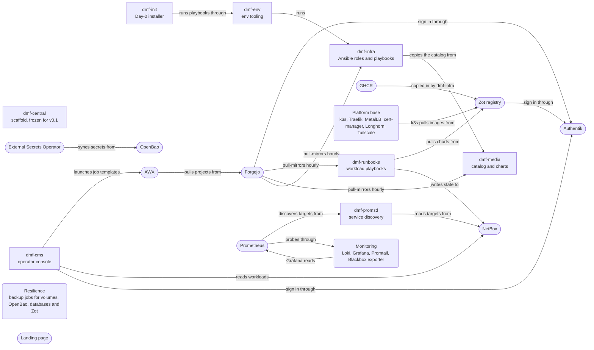

# The parts of the platform

This page shows the component repos, the services on the main paths, and the calls between them. Boxes are component repos.
Stadium shapes are services. Rounded boxes are groups of services, with their members listed. An arrow points from the caller
to the part it calls. The `dmf-infra` playbooks install every service in the diagram except GHCR, which is the project's public registry, and they install `dmf-promsd` and `dmf-cms` too. The
[Services](#services) table lists each service once, including the members of the groups.

Not drawn: the host setup that runs before k3s (baseline, time sync, hardening, kernel mitigations), which installs no service,
and the network policies for OpenBao. The repo `dmfdeploy` is the umbrella of these docs and makes no calls.

## What comes from GitHub

GitHub and GHCR are the public source. AWX and pods use the cluster's own copies, but Forgejo pulls from GitHub every hour by
default.

| What | From | Into | By |
|---|---|---|---|
| The `dmf-runbooks`, `dmf-media` and `dmf-infra` repos | GitHub | Forgejo | Pull-mirror, hourly by default |
| Helm charts, and the images of the platform and the media functions | GHCR (two images come from another public registry) | Zot | Playbook 630, at bootstrap and when you re-run it |

## Services

Paths are relative to `k3s-lab-bootstrap/` in the `dmf-infra` repo.

| Service | Layer | Installed by | What it is for |
|---|---|---|---|
| k3s | Platform base | `playbooks/300-k3s.yml` | Runs the containers |
| Traefik | Platform base | `playbooks/310-ingress-public.yml`, `playbooks/311-ingress-private.yml` | Routes web traffic into the cluster |
| MetalLB | Platform base | `roles/base/ingress`, called by `playbooks/310-ingress-public.yml` in the MetalLB ingress modes only | Gives services an address on the local network |
| cert-manager | Platform base | `playbooks/320-cert-manager.yml` | Issues TLS certificates |
| Longhorn | Platform base | `playbooks/330-longhorn.yml` (cloud provider profile only) | Stores volumes, replicated across nodes |
| Tailscale | Platform base | `playbooks/321-tailscale.yml` (cloud provider profile only) | Connects the nodes, and sets public DNS |
| Forgejo | Delivery | `playbooks/620-forgejo.yml`, `playbooks/692-forgejo-bootstrap.yml` | Holds the Git repos that AWX reads |
| Zot registry | Delivery | `playbooks/331-registry-zot.yml`, `playbooks/630-zot-seed-platform.yml` | Serves the images and Helm charts that pods use |
| OpenBao | Security and secrets | `playbooks/vertical-security/100-openbao.yml` | Stores the platform's secrets |
| External Secrets Operator | Security and secrets | `playbooks/vertical-orchestration/100-eso.yml` | Copies secrets from OpenBao into Kubernetes Secrets |
| Authentik | Security and secrets | `playbooks/vertical-security/110-authentik.yml` | Signs users in, with passkeys |
| NetBox | Source of truth and orchestration | `playbooks/610-netbox.yml` | Records the inventory and the state of each workload |
| AWX | Source of truth and orchestration | `playbooks/640-awx.yml`, `playbooks/693-awx-integration.yml` | Runs the playbooks that deploy workloads |
| Prometheus | Monitoring | `playbooks/vertical-monitoring/100-prometheus.yml` | Collects metrics and alert rules |
| Loki | Monitoring | `playbooks/vertical-monitoring/110-loki.yml` | Stores logs |
| Grafana | Monitoring | `playbooks/vertical-monitoring/120-grafana.yml` | Shows metrics and logs |
| Promtail | Monitoring | `playbooks/vertical-monitoring/130-promtail.yml` | Sends logs to Loki |
| Blackbox exporter | Monitoring | `playbooks/vertical-monitoring/150-blackbox.yml` | Probes endpoints from the outside |
| dmf-promsd | Monitoring | `playbooks/vertical-monitoring/160-promsd.yml` | Gives Prometheus its targets from NetBox |
| Backup jobs | Resilience | `playbooks/vertical-resilience/110-longhorn-backup-target.yml` to `140-zot-mirror.yml` (cloud provider profile only) | Back up volumes, OpenBao, the databases and Zot to object storage |
| dmf-cms | Operator surface | `playbooks/650-dmf-cms.yml` | Is the operator console |
| Landing page | Operator surface | `playbooks/600-landing-page.yml` | Links to the platform's web pages |
