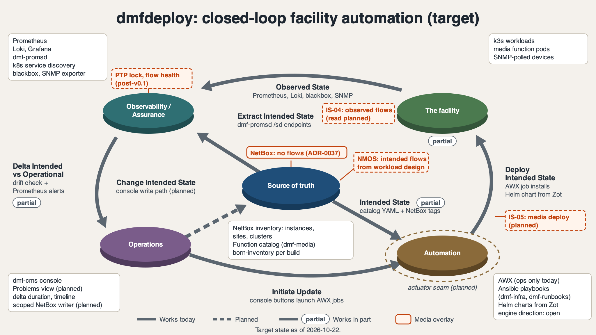

# DMF Closed-Loop Assurance Pattern Plan

This plan maps a common closed-loop network automation pattern onto
dmfdeploy, lists the gaps, and records where dmfdeploy differs on purpose.
It's unscheduled design state, tracked by
[#669](https://github.com/dmfdeploy/dmfdeploy/issues/669). Nothing here is
built yet. Pick it up from §5.

## 1. The pattern

A source of truth sits at the centre. Four functions surround it: the
managed network, observability and assurance, automation, and operations.
Seven flows join them:

| # | From | To | Flow |
|---|---|---|---|
| 1 | Network | Assurance | Observed state |
| 2 | Source of truth | Assurance | Extract intended state |
| 3 | Assurance | Operations | Delta between intended and operational state |
| 4 | Operations | Source of truth | Change intended state |
| 5 | Operations | Automation | Initiate update |
| 6 | Source of truth | Automation | Intended state |
| 7 | Automation | Network | Deploy intended state |

Intent lives only in the source of truth. Automation deploys it, assurance
checks it, and operations acts on each delta. Then the loop repeats.

## 2. Mapping to dmfdeploy

Evidence is from each repo's `main` on 2026-10-21.

| Pattern element | dmfdeploy today | Match |
|---|---|---|
| Source of truth | NetBox, deployed by dmf-infra `610-netbox.yml`. See [ADR-0013](../decisions/0013-media-function-catalog-model.md), [ADR-0037](../decisions/0037-media-workloads-netbox-instance-inventory.md) and [ADR-0039](../decisions/0039-environment-identity-netbox-site-cluster.md). | Full |
| Intent content | Catalog YAML in dmf-media `catalog/` joined to a NetBox runtime tag (ADR-0013). NetBox holds instances only, never flows and never live state (ADR-0037). | Partial, by design |
| Writers to the source of truth | Scoped service accounts ([ADR-0032](../decisions/0032-catalog-launcher-scoped-netbox-writer.md)); dmf-infra `691-netbox-sot.yml` and `694-born-inventory.yml` | Full |
| Automation | AWX runs the `media-*` launchers in cluster pods and installs Helm charts from Zot ([ADR-0025](../decisions/0025-ansible-in-cluster-pods-and-catalog-helm.md), [ADR-0014](../decisions/0014-awx-project-layout.md)). AWX is for operations only; the workflow engine direction is still open. | Full today |
| Deploy intended state (7) | Console Configure and Finalise launch AWX jobs (dmf-cms `catalog.py`, `operations.py`). | Full |
| Network | k3s workloads, including dmf-media `charts/nmos-cpp` and `charts/nmos-crosspoint`. Physical devices only through the SNMP lane. | Partial |
| Observed state (1) | The monitoring vertical in dmf-infra `playbooks/vertical-monitoring/`: Prometheus, Loki, Grafana, blackbox, SNMP exporter. | Full |
| Extract intended state (2) | dmf-promsd serves `/sd/scrape`, `/sd/probe` and `/sd/snmp` from NetBox tags and custom fields ([ADR-0038](../decisions/0038-netbox-driven-dynamic-monitoring.md)). | Full for monitoring targets |
| Delta (3) | dmf-infra `playbooks/lifecycle/operate-catalog-drift.yml` compares NetBox tags with Helm state. Prometheus alerts cover health. The drift detector has never fired on real drift ([OPEN-QUESTIONS](../OPEN-QUESTIONS.md)). | Partial |
| Operations | The console Operations view and an alert push bridge in the Prometheus role. Nothing turns an alert or a drift result into an operator action. | Missing |
| Change intended state (4) | dmf-cms `netbox.py` only reads. No console path writes intent to NetBox yet. | Missing |
| Initiate update (5) | Console buttons launch AWX jobs. | Full |

## 3. Operator ruling (2026-10-21)

NMOS stays the source of media intent. The NetBox media plugin stays frozen
(post-v0.1 in [OPEN-QUESTIONS](../OPEN-QUESTIONS.md)). NetBox keeps
instances, sites and clusters. Senders, receivers and flows come from the
NMOS IS-04 registry and IS-05 connection state.

## 4. Deliberate differences

- **Media intent comes from NMOS.** Flows change too often to store in
  NetBox, and ADR-0037 already keeps them out. The console compares
  observed flows from the registry with the workload design. dmf-cms
  `switch_source.py` already plans an `nmos-is05` actuator.
- **Media observed state.** The pattern has one observed-state flow. A media
  facility also needs PTP lock and flow health. The catalog-v2 roles
  `ptp-monitor` and `flow-exporters` are frozen until after v0.1.
- **Short-lived environments.** Environments are rebuilt often, and
  born-inventory registers each build (ADR-0039). A rebuild must not raise a
  delta.
- **Two discovery lanes.** Kubernetes service discovery covers pods. NetBox
  `http_sd` covers the rest (ADR-0038). The pattern's single extract flow
  covers only the second lane.
- **Scoped writes.** Operations changes intent through scoped accounts
  (ADR-0032). No function gets a general NetBox write token.

## 5. Gaps and candidate issues

File each one as its own issue when the open questions have answers.

1. **Problems view for deltas** (dmf-cms, dmf-infra). An Alertmanager
   receiver and a console view list each delta with its duration and
   timeline, so the operator can act on it. This closes flow 3.
2. **Drift detector proof** (dmf-infra). Record one fault-injection run of
   `operate-catalog-drift.yml` before anything depends on it.
3. **Change-intent path** (dmf-cms). A console action writes intent to
   NetBox through a scoped account. This closes flow 4.
4. **Actuator seam** (dmf-cms, dmf-runbooks). Deploy and drift actions go
   through one interface, so the loop keeps working if the workflow engine
   changes.
5. **NMOS flow comparison** (dmf-cms, dmf-media). Compare registry and
   IS-05 state with the workload design, and report each difference as a
   delta.

## 6. Open questions

1. Is the console the only operations surface, or should a delta also open a
   ticket somewhere else?
2. Does attribution of intent changes wait for the identity decision
   (ADR-0028 may be stale)?
3. Should the actuator seam come before or after the workflow engine RFC?
4. Where does a workload's intended flow set live durably, given ADR-0037
   keeps flows out of NetBox?

## 7. Target diagram

The diagram keeps the pattern's layout: five discs and the seven flows of
§1, with each flow's original label. A subtitle under each label names the
dmfdeploy part that carries it. Line style follows the §2 mapping: solid
lines work today, a "partial" marker means the §2 row is partial, and dashed
lines are planned. The disc for the managed system is called "The facility"
because it holds k3s workloads and media function pods as well as devices.

Media intent from §3 sits on its own overlay, drawn in one accent colour:
the IS-04 registry as observed flows, IS-05 as the media deploy path,
intended flows from the workload design, PTP lock and flow health, and the
ADR-0037 note. [The base diagram](diagrams/closed-loop-target-base.png)
shows the loop without the overlay.

### Files

| File | Use |
|---|---|
| [`closed-loop-target.svg`](diagrams/closed-loop-target.svg) | Layered source. Edit this file. |
| [`closed-loop-target-outlined.svg`](diagrams/closed-loop-target-outlined.svg) | The same layers with text converted to paths, for tools that don't import SVG text. |
| [`closed-loop-target.png`](diagrams/closed-loop-target.png) | Full render at 2048x1152. |
| [`closed-loop-target-base.png`](diagrams/closed-loop-target-base.png) | Render without the media overlay. |

### Layers for motion graphics

The SVG is plain: no styles, classes, markers, filters, masks or `<use>`.
Each animatable element is one top-level group with a stable id, listed
here back to front:

1. `bg`, `title`, `footer`, `legend`.
2. `arrow-1-observed-state` to `arrow-7-deploy-intended-state`. Each group
   holds the arrow as one stroked path, its arrowhead as a separate path, and
   its label lines, so a stroke-draw animation works on the main path.
3. `seam-actuator`.
4. `disc-assurance`, `disc-network` (labelled "The facility"), `disc-sot`,
   `disc-operations`, `disc-automation`.
5. `labels-assurance`, `labels-network`, `labels-sot`, `labels-operations`,
   `labels-automation`.
6. `overlay-media`, with the sub-groups `overlay-media-is04`,
   `overlay-media-is05`, `overlay-media-ptp-flow-health`,
   `overlay-media-flows`, `overlay-media-note` and `overlay-media-legend`.

A suggested sequence: fade in the background and title, then the discs
with their label cards. Draw the arrows in loop order 7, 1, 2, 3, 4, 5, 6,
then fade in the seam, the legend and the footer. Bring in the media overlay
after the base loop has drawn.
