Part: The admin's path, from an empty machine to steady state
# Approving rare, powerful actions with a device you hold
## A proposed design for the sandbox lane
- Follow nine steps, from an empty machine to losing a device.
- The walkthrough describes the intended design. Implementation is pending.
- The final slides offer recommendations for decisions that remain open.
Notes: OpenBao is the platform's vault. This deck describes the sandbox lane's intended self-recovering posture, the single-machine starter setup. The picture story comes first (slides 2 to 11), followed by the detailed walkthrough (slides 12 to 27). The proposal slides are recommendations awaiting approval.
---
Part: The story in pictures
Layout: picture
# The idea in one picture
## The machine opens the vault :lock-open: so the platform can run. Only you, with your passkey, can take full control.
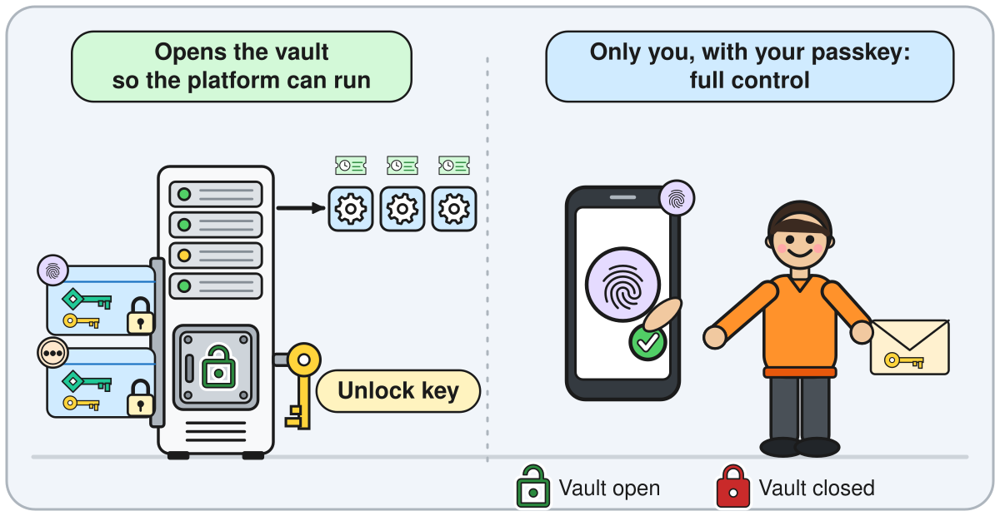
Notes: The operator decided that the system stores one encrypted copy of the recovery keys and the seal key for each enrolled passkey. The copy is useless without that passkey. A passkey can sync to more than one physical device. The plan accepts local root access to the machine as a known risk in this lane. How a compromised running machine affects a later approval is not analysed in the plan. Treat it as a design question. The text walkthrough follows later in the deck.
---
Part: The story in pictures
Layout: picture
# Step 1: start with one empty machine
## You start the installer and point it at one empty machine. You keep the backup and its passphrase.
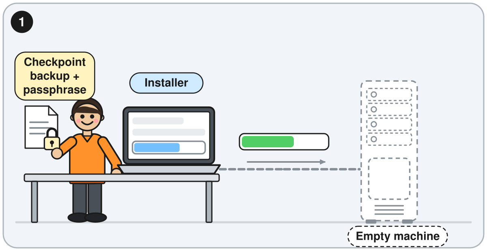
Notes: The text walkthrough for this step follows later in the deck.
---
Part: The story in pictures
Layout: picture
# Step 2: the machine unlocks itself
## You do nothing. The vault opens by itself :lock-open:.
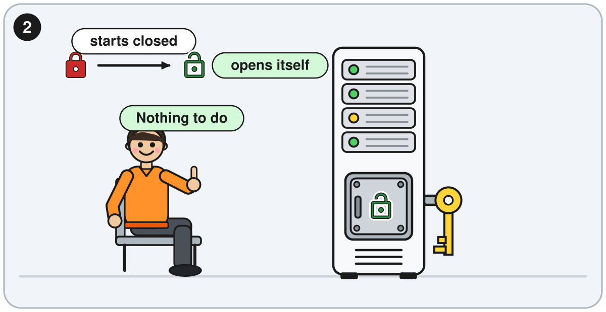
Notes: The text walkthrough for this step follows later in the deck.
---
Part: The story in pictures
Layout: picture
# Step 3: enrol two passkeys
## Each enrolled passkey has its own encrypted copy, stored on the machine.
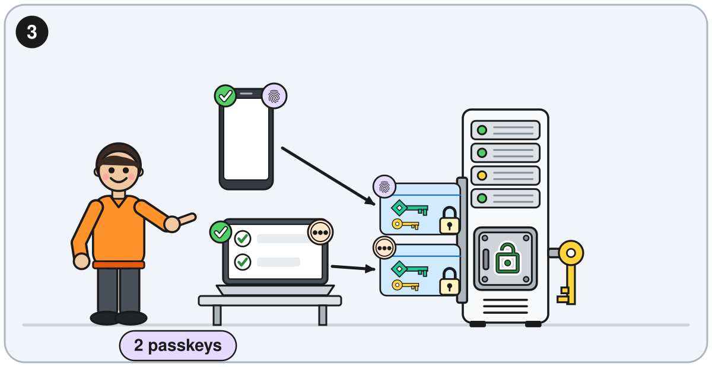
Notes: Two independent passkeys are recommended in the proposal slides. Support for the PRF output on a hardware security key has not been confirmed in device tests yet. A passkey that syncs to two devices is still one credential with one copy. The text walkthrough for this step follows later in the deck.
---
Part: The story in pictures
Layout: picture
# Step 4: keep the recovery package
## You keep it. It holds one copy of the unlock key.
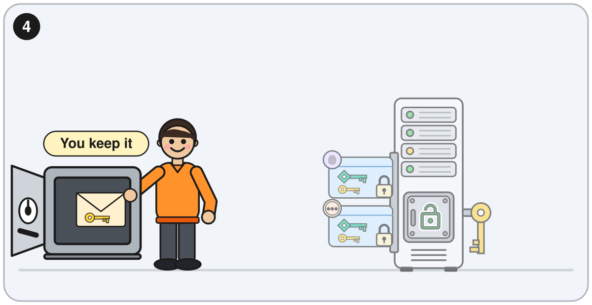
Notes: The text walkthrough for this step follows later in the deck.
---
Part: The story in pictures
Layout: picture
# Step 5: a root token for one planned change
## You sign in as the admin, then approve with your passkey. The executor uses the root token once to make a narrow token, and revokes the root token at once.
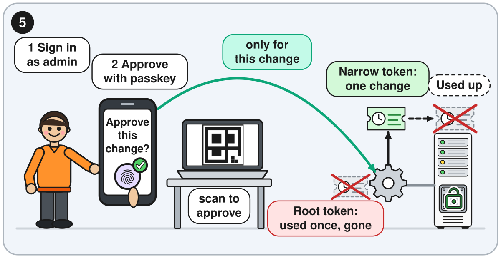
Notes: This is the intended execution flow. The plan accepts local root access to the machine as a known risk. It does not analyse a compromised machine during an approval. Treat that as a design question. The text walkthrough for this step follows later in the deck.
---
Part: The story in pictures
Layout: picture
# Step 6: a normal day
## Most days, you do nothing.
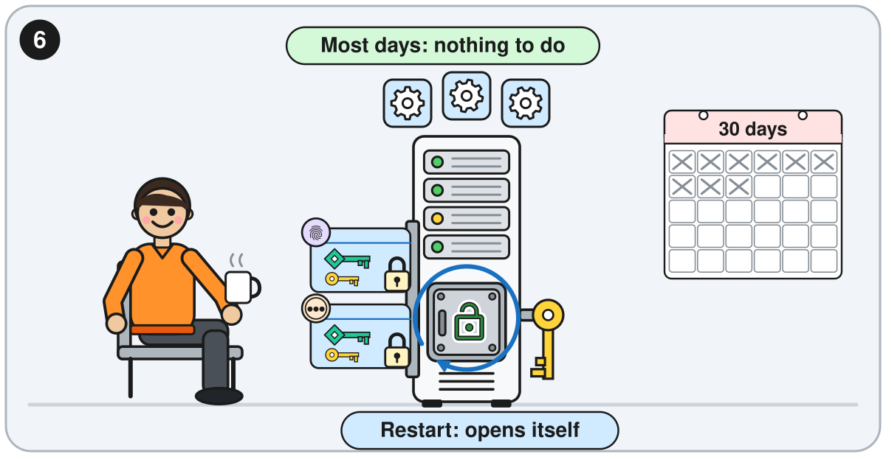
Notes: The text walkthrough for this step follows later in the deck.
---
Part: The story in pictures
Layout: picture
# Step 7: restore from a snapshot
## You confirm with your passkey. The copy stored with the snapshot gives back the unlock key.
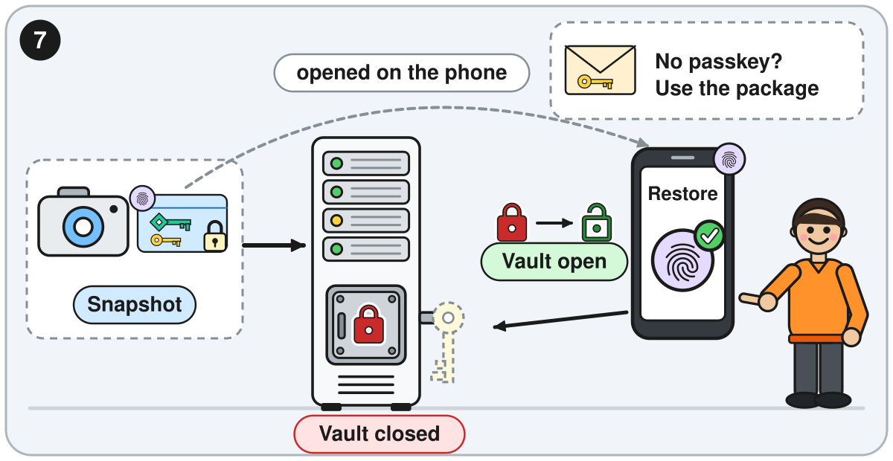
Notes: The plan describes a restore with one confirmation after every copy of the seal key on the nodes is lost. The seal type and the complete recovery procedure still need to be chosen and tested. The recovery package is the fallback when no enrolled passkey is available. The text walkthrough for this step follows later in the deck.
---
Part: The story in pictures
Layout: picture
# Step 8: check in every 30 days
## One confirmation on a device starts a new 30 days.
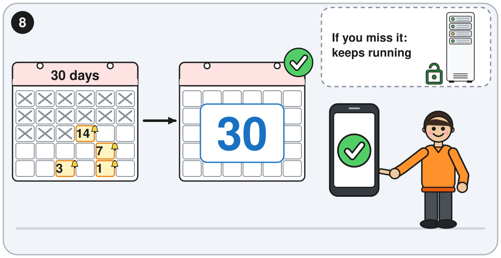
Notes: The text walkthrough for this step follows later in the deck.
---
Part: The story in pictures
Layout: picture
# Step 9: lose a device, keep control
## Remove the lost passkey. The keys are replaced and the recovery package is reissued.
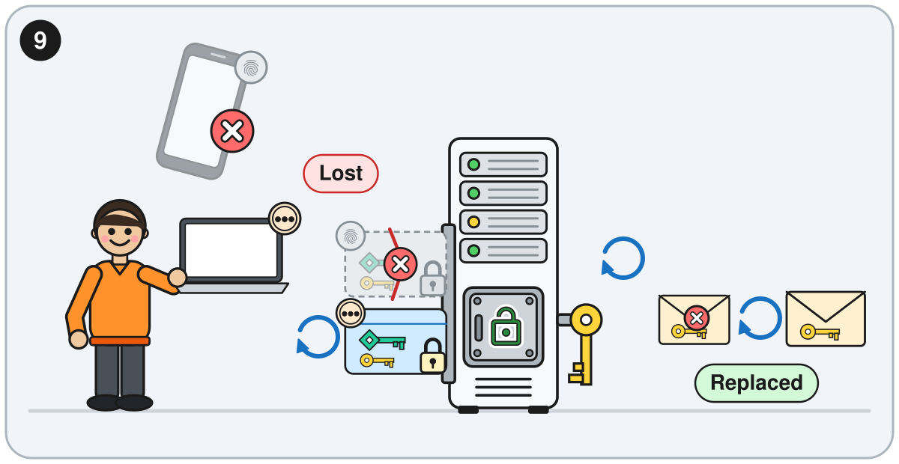
Notes: The sources do not say who approves a removal, or what happens when only one passkey remains. The proposal slides offer recommendations. A passkey can sync to more than one physical device. The text walkthrough for this step follows later in the deck.
---
Part: The idea
# The machine opens the vault so the platform can run. Only you, with your passkey, can take full control.
- With the vault open :lock-open:, the system hands secrets to the apps through a helper. Each service and automation identity reads only what its policy allows. The admin manages app secrets day to day, and the system rotates secrets and takes backups.
- Every request still needs a sign-in. An open vault does not give secrets to anyone who asks. When the vault is closed :lock-closed:, nothing new can be issued or rotated.
- Full control means two things: a temporary root token for a planned change, and a restore from a backup.
- The machine keeps an encrypted copy of the recovery keys and the seal key for each enrolled passkey. Your device decrypts it locally after a fingerprint, face or screen-lock check, only for the operation you approved.
- The seal key opens the vault. The recovery keys approve root tokens and restores.
Notes: A root token is the vault's all-powerful credential. Recovery keys cannot open the vault. They authorize actions such as creating a root token. In the sandbox lane the operator decided that the encrypted copies live on the system instead of on each device. A passkey that syncs to two devices is still one credential with one copy. Someone who has only the machine's disk can read the vault data, because the machine holds the seal key. That person cannot create a root token, because the recovery keys are not on the machine in plain form. During an approval, your device sends the unwrapped key material to the approved session on the machine. A compromised machine could therefore capture it. This is our analysis, not a stated property of the design, and the plan accepts local root access as a known risk. What a compromised running machine can do during a later approval is a design question.
---
Part: Step 1 of 9: install
# Start with one empty machine
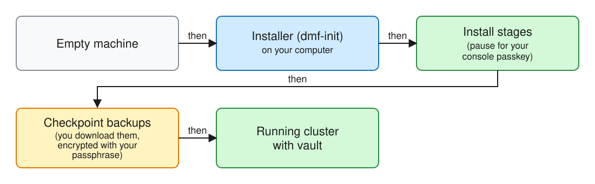
- [do] Start dmf-init on your own computer and point it at one empty machine.
- [see] The installer moves through its stages and asks for your console passkey. At each checkpoint it offers a backup to download, encrypted with your passphrase.
- [holds] The machine holds a running cluster, a local certificate authority, and one narrow policy for each change you can approve later. You hold the passphrase and the downloaded backups.
Notes: The sequence for creating recovery material and handing over the recovery package is a recommendation in the final slides. dmf-init uses a disposable container and a memory-only working folder. The recovery package and checkpoint backup serve different purposes.
---
Part: Step 2 of 9: first unlock
# The machine unlocks itself
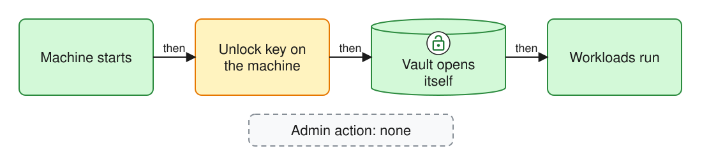
- [do] Nothing. The sandbox design has no manual unlock step at startup.
- [see] The cluster comes up with the vault open :lock-open:.
- [holds] The unlock key (the seal key) stays on the machine, by design. The recovery keys are not on the machine in plain form. Each enrolled passkey has an encrypted copy.
Notes: This is the intended Tier 3 sandbox posture. It is not the Tier 2 cold-boot unlock flow. The chosen seal provider and its recovery procedure still need to be established and tested.
---
Part: Step 3 of 9: enrol passkeys
# Enrol two passkeys
- [do] Register your first approval passkey, then enrol a second. A passkey lives on a phone, a laptop or tablet with a built-in authenticator, or a hardware security key with a PIN. The install is not complete without two.
- [see] The enrolment tells you that a takeover of your passkey sync account is a remote risk. The accepted risk of local access to the machine does not cover it.
- [holds] The system keeps an encrypted copy of the recovery keys and the seal key for each enrolled passkey, and records each enrolment. One passkey can approve alone.
- A passkey synced to two devices is still one credential.
Notes: Later enrolment happens in the running console after sign-in. The approval page does not enrol. A site whose approval-page host name changes must enrol again. Support for the PRF output on a hardware security key with a PIN remains unconfirmed. The operator decided that the system stores the encrypted copies.
---
Part: Step 4 of 9: recovery package
# Keep the recovery package
- [do] Keep the recovery package in your own custody. In the sandbox lane you are its only custodian.
- [see] How the package reaches you is a proposal for decision. It is separate from the installer's checkpoint backup.
- [holds] One direct copy of the unlock key (the seal key). The plan says the package approves when no passkey is available.
- The material needed for replacement enrolment and check-in still needs to be specified.
Notes: The plan calls for the package to support restore, check-in and replacement enrolment. Recovery keys authorize and cannot open the vault, so a seal key copy alone does not establish how the latter two work. Specify and test package contents and each recovery operation. The plan sets one custodian: you.
---
Part: Step 5 of 9: first root token
# A root token for one planned change
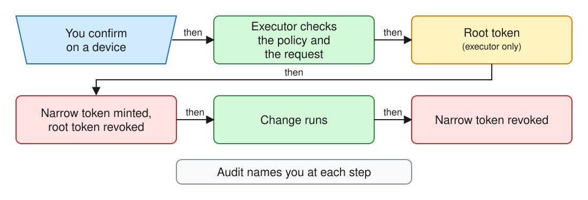
- [do] Start a privileged change. Sign in as the admin account first, then approve with your passkey. After the planned vault upgrade, a root token needs both.
- [see] The approval names the operation and shows a request fingerprint.
- [holds] The intended executor mints a narrow token, revokes the root token, runs the change, then revokes the narrow token. No token is kept. The audit names you at each step.
Notes: A signed-in admin starting the operation and seeing progress is recommended in the final slides. The executor compares the live policy and the approved request with pinned fingerprints, so a policy or request changed after approval is refused before anything is minted. The session link alone approves nothing. A session accepts one submission, expires after a short time and cannot be replayed. The laptop that shows the QR code never sees key material. How these checks hold up against a compromised running machine is a design question that the plan does not analyse.
---
Part: Step 6 of 9: a normal day
# Most days, you do nothing
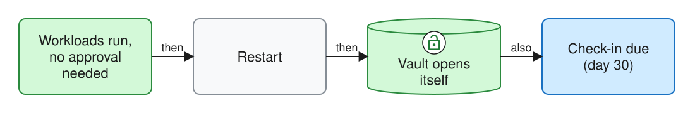
- [do] Approve rare privileged changes and check in when prompted.
- [see] Workloads keep running. If the machine restarts, the vault opens by itself :lock-open:.
- [holds] The machine stores the unlock key, the encrypted copies, audit records and the check-in deadline.
Notes: No routine account holds the power to create a root token. The design aims to avoid storing routine credentials for the main External Secrets login that could expire while the cluster is off. The sandbox's independent check-in reminder channel is not yet specified.
---
Part: Step 7 of 9: restore
# Restore from a snapshot with one confirmation
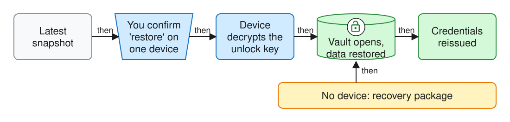
- [do] Start a restore in the installer and approve it with an enrolled passkey.
- [see] The approval screen names the operation "restore". You confirm once, with one passkey. If your authenticator is on another device, a QR code carries the confirmation to it.
- [holds] A copy of the unlock key is stored with the snapshot, encrypted for each passkey. The vault opens with the restored key :lock-open:. Your passkeys still approve, with no new enrolment.
Notes: The fallback uses the recovery package. Snapshot frequency, backup destination and exact restore initiation are recommendations in the final slides. A snapshot and the recovery keys alone are not enough. Recovery keys cannot open the vault, so the seal key has its own backup. A snapshot from before removal can remain accessible using old key material.
---
Part: Step 8 of 9: the 30-day check-in
# Check in every 30 days
- [why] The check-in helps reveal a missing credential before the next privileged operation.
- [do] Confirm with an enrolled passkey. An approval also starts a new 30 days.
- [see] Warnings at 14, 7, 3 and 1 days, each with a one-tap check-in link, and the last check-in for each passkey.
- [miss] Workloads continue and the machine still unlocks itself. Privileged changes wait until a check-in or recovery path succeeds.
Notes: The deadline persists across restarts, and time while the machine is off counts. Root access to the node can disable the timer. The plan calls for the recovery package to work after expiry, but the package contents and procedure need verification. An independent notification channel is not yet specified.
---
Part: Step 9 of 9: lose a device
# Lose a device, keep control
- [do] Remove the lost passkey. Your other passkey keeps approving on its own. Enrol a replacement in the console.
- [see] The system records the removal. The record states that snapshots taken before it still open with the old unlock key.
- [holds] Removal replaces the recovery keys and the seal key, and re-encrypts the copies for the remaining passkeys. The removed passkey's copy stops working. The recovery package is reissued.
Notes: The sources do not say who approves a removal, or what happens when only one passkey remains. The proposal slides offer recommendations. The exact rotation procedure and interrupted-rekey recovery require tests on the chosen OpenBao version and seal type.
---
Part: Summary
# What each place holds
| After step | The machine | Each enrolled passkey | Snapshots | Recovery package |
|---|---|---|---|---|
| 1 Install | Cluster, unlock key, narrow policies | - | - | - |
| 2 First unlock | Vault opens itself :lock-open: | - | - | - |
| 3 Enrol | Encrypted copy per passkey, audit record | The passkey itself | Unlock key copy per passkey | - |
| 4 Package | - | - | - | One direct copy of the unlock key |
| 5 Root token | Audit records, no token kept | Same passkey, never sees the token | - | - |
| 6 Normal day | Check-in deadline | Same passkey | - | - |
| 7 Restore | Restored data | Passkey approves, no new enrolment | Latest snapshot used | Completes a restore if no passkey is available |
| 8 Check-in | New deadline, last check-in per passkey | - | - | Can check in if no passkey is available |
| 9 Lose a device | New recovery keys and unlock key, new copies | Removed passkey's copy stops working | Copies re-encrypted | Reissued |
Notes: A dash means the step does not change that column. A passkey synced to two devices counts once.
---
Part: Summary
# What the sandbox design can promise
- The machine opens the vault :lock-open: so the platform can run. Only you, with your passkey, can take full control.
- Full control means a temporary root token for a planned change, and a restore from a backup.
- The machine keeps an encrypted copy of the recovery keys and the seal key for each enrolled passkey. Your device decrypts it only for the operation you approved.
- Someone who has only the machine's disk can read the vault data. That person cannot create a root token.
- Design question: what a compromised running machine can capture during a later approval.
Notes: The plan accepts physical and local root access to the machine as a known risk in this lane. Taking over the passkey sync account is a separate, remote risk. The plan limits it with encrypted copies on access-controlled storage, approval pages on the private network only, and an audit record of every use. Each audit record carries the hash of the previous record and a sequence number. The chain shows accidental changes. It does not prove that nobody edited the records on purpose. Whether a malicious administrator who controls the approval page or the executor could alter an approval is our analysis, not a statement in the plan.
---
Part: Recommendations for decision
# Installation and recovery package
## Proposal for decision
- Create the seal key and recovery keys during first install, before passkey enrolment.
- Guide the admin through two independent credentials, a package download and verification.
- Encrypt the package with its own passphrase. Keep the package and its passphrase away from the machine.
- Specify and test the package material needed for restore, replacement enrolment and check-in.
Notes: These recommendations await an operator decision. Keep the setup handoff short and avoid retaining plaintext recovery material after the ceremony. Confirm that the selected seal type supports the proposed recovery approach.
---
Part: Recommendations for decision
# Privileged changes and restore
## Proposal for decision
- Let the signed-in admin start a named privileged change in the console.
- Show approval, running, success or failure, with an audit reference.
- In dmf-init, show the restore point with its timestamp before confirming. The plan restores the latest snapshot, so choosing an earlier one needs a decision.
- Start with hourly snapshots and a daily off-machine copy. Alert on stale backups and test restores.
Notes: Snapshot frequency is a configurable sandbox default proposed for decision. The recovery point target and backup retention require an operator decision. Verify backups independently and keep seal recovery material available outside the failed machine.
---
Part: Recommendations for decision
# Reminders and lost credentials
## Proposal for decision
- Use console warnings as the baseline. Offer optional email to a configured admin address.
- A retained credential or the recovery package approves removal of a lost credential.
- Allow removal when it leaves one credential. Warn and prompt the admin to add a backup. The plan says the lane needs at least two enrolled devices, so this needs an exception.
- Count independent credentials. Two devices sharing one synced passkey do not provide independent credentials.
Notes: These are recommendations. Package-assisted removal and enrolment depend on the unresolved package contents and a tested procedure. Rotation cannot revoke access to an old snapshot already copied with its old key material.
---
Part: Recommendations for decision
# Separate console sign-in from approval
## Proposal for decision
- Enrol separate credentials for console sign-in and approval of privileged actions.
- Explain their different roles in one guided setup.
- An extra enrolment and potentially an extra prompt buy independent lifecycle and revocation.
- Review the approval client and executor trust boundary before promising protection from machine administrators.
Notes: These recommendations await a design decision. Support for the PRF output on a hardware security key and the full approval session still need real-device tests. During an approval, the machine's session receives the unwrapped key material. A malicious host could capture it. This is our analysis.
